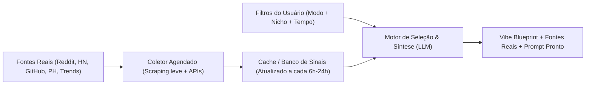

# Brainstorm — Gerador de Ideias para VibeCoding

> Documento de concepção, ideação, arquitetura e roadmap do projeto.

---

## 1. Visão Geral & Proposta de Valor

### O Problema
Na era do **VibeCoding** (construção acelerada de software com IA), a barreira técnica para tirar um projeto do papel caiu drasticamente. Hoje, o maior gargalo de devs, estudantes, participantes de hackathons e indie hackers não é *como codar*, mas sim **o que construir que realmente faça sentido agora**.

Geradores de ideias tradicionais entregam sugestões genéricas e batidas ("faça um app de to-do", "faça um clone do Twitter").

### A Solução
Um **Gerador de Ideias Vivo para VibeCoding**, conectado a sinais reais e atuais da internet (tendências, reclamações de usuários, lançamentos e repositórios em alta). O usuário escolhe o **contexto** (Hackathon, Retorno Monetário, Estudo, Desafio) e os **filtros** (Saúde, Educação, Finanças, etc.), e a plataforma sorteia/sintetiza ideias atualizadas, acompanhadas de um **Blueprint pronto para começar a vibecodar imediatamente** — incluindo um **Prompt Mestre** copiável.

---

## 2. Sugestões de Nome (Naming)

| Categoria | Nome | Vibe / Por que funciona |
| :--- | :--- | :--- |
| **Direto & Memorável** | **VibeSpark** | Curto, global, remete à faísca inicial de um projeto de VibeCoding. |
| **Foco em Construção** | **VibeForge** | Passa ideia de "forjar" projetos reais a partir de tendências brutas. |
| **Foco em Tendência** | **PulseVibe** | Conecta o "pulso do mercado/internet" com a criação rápida. |
| **Gamificado / Diversão** | **VibeRoulette** | Ótimo para desafios, lives, estudos e hackathons (estilo roleta de ideias). |
| **Foco em Lançar / Negócio** | **ShipSpark** | Forte apelo indie hacker / Micro-SaaS ("ideia -> ship rápido"). |
| **Híbrido / Brasileiro** | **VibeLab** | Simples, limpo, funciona bem em português e inglês. |
| **Foco em Descoberta** | **TrendVibe** | Deixa explícito o diferencial de usar tendências atuais. |

> **Top 3 recomendações:** `VibeSpark` (mais versátil), `VibeRoulette` (mais divertido/viral) e `PulseVibe` (mais focado em dados/mercado).

---

## 3. Modos de Uso (Objetivos)

O usuário começa escolhendo **para quê** ele quer a ideia:

1. **💰 Retorno Monetário (Micro-SaaS / Indie)**
   - Foco em dores reais onde pessoas já reclamam ou gastam dinheiro.
   - Prioriza nichos específicos (B2B pequeno, freelancers, criadores, PMEs) com modelo claro de receita (assinatura, pay-per-use, licença única).
2. **🏆 Hackathon**
   - Foco em alto impacto de apresentação (demo impressionante em 3 minutos), problema urgente, diferencial tecnológico (IA, automação, dados em tempo real) e escopo executável em 24h–48h.
3. **📚 Estudo & Portfólio**
   - Foco em dominar conceitos ou tecnologias específicas (ex: agentes de IA, WebSockets, scraping, auth, pagamentos, mobile).
   - Ajustável por nível: Iniciante, Intermediário ou Avançado.
4. **⚡ Desafio Relâmpago (Speedrun)**
   - Ideias enxutas para construir em 2h, 6h ou 1 fim de semana.
   - Pode incluir **restrições criativas** opcionais (ex: *"sem banco de dados"*, *"interface de 1 única tela"*, *"extensão de Chrome"*).

---

## 4. Sistema de Filtros

- **Nichos / Indústrias:**
  - Educação (EdTech)
  - Saúde & Bem-estar (HealthTech)
  - Finanças Pessoais & PMEs (FinTech)
  - Produtividade & Trabalho Remoto
  - DevTools & Inteligência Artificial
  - E-commerce, Marketing & Vendas
  - Criadores de Conteúdo & Mídia
  - Negócios Locais & Serviços (clínicas, restaurantes, imobiliárias)
  - Entretenimento, Games & Comunidades
  - Sustentabilidade & Impacto Social
- **Formato do Produto:**
  - Web App / Micro-SaaS
  - Extensão de Navegador
  - Bot (WhatsApp, Telegram, Discord)
  - Agente de IA / Automação
  - App Mobile / PWA
  - Ferramenta CLI / Biblioteca Dev
- **Tempo Disponível:** `2 horas` · `1 dia` · `Fim de semana (48h)` · `1 semana+`
- **Nível Técnico:** `Iniciante` · `Intermediário` · `Avançado`
- **Público-alvo:** `B2C` · `B2B / PMEs` · `Freelancers / Criadores` · `Desenvolvedores`

---

## 5. Motor de Tendências (Web Scraping + Fontes Reais)

Para sortear temas **realmente atuais e rentáveis** sem depender de um scraper frágil que quebra toda semana, a melhor estratégia é um **Trend Engine híbrido** (APIs públicas gratuitas + RSS + scraping leve com cache):

### Fontes de Sinais Recomendadas

| Fonte | Tipo de Coleta | O que extrai | Melhor para qual modo? |
| :--- | :--- | :--- | :--- |
| **Reddit** (`r/SomebodyMakeThis`, `r/SaaS`, `r/microsaas`, `r/Entrepreneur`, `r/SideProject`) | Endpoints `.json` / RSS | Reclamações reais, "queria um app que fizesse X", validações de mercado | 💰 Retorno Monetário |
| **Hacker News** (`Ask HN`, `Show HN`, Top Stories) | Firebase API pública gratuita | Tendências tech, ferramentas novas, debates quentes | 🏆 Hackathon, 📚 Estudo, 💰 Micro-SaaS |
| **GitHub Trending** | Scraping leve (HTML + Cheerio) | Repositórios e stacks explodindo na semana | 📚 Estudo, 🏆 Hackathon |
| **Product Hunt** | RSS / API oficial | Produtos lançados hoje que estão ganhando tração | 💰 Retorno Monetário, 🏆 Hackathon |
| **Hugging Face Trending** | API pública | Novos modelos/Spaces de IA abrindo possibilidades inéditas | 🏆 Hackathon, 📚 Estudo |
| **Google Trends (RSS)** | Feed RSS diário por país | Assuntos com pico repentino de busca (ex: Brasil / Global) | ⚡ Desafio, 🏆 Hackathon |

### Como funciona o Pipeline (Fluxo de Dados)

1. **Coleta em Background (Cache):** Um job agendado (ou sob demanda com cache de 6h) coleta os tópicos em alta e extrai sinais (título, contexto, engajamento, categoria e URL original).
2. **Ranqueamento & Sorteio Ponderado:** Quando o usuário escolhe, por exemplo, *Retorno Monetário + Saúde*, o sistema seleciona sinais recentes relevantes (ou cruza uma tendência tech quente com o nicho Saúde).
3. **Síntese com IA (Structured Output):** Um modelo de IA transforma os sinais brutos em uma ideia concreta, original e factível no tempo escolhido, citando **por que isso está em alta agora** com link para a fonte.

---

## 6. O que o Gerador Entrega ("Vibe Blueprint")

Cada ideia sorteada vem como um cartão acionável completo:

1. **Nome Sugerido & Pitch em 1 frase**
2. **Por que agora? (Sinal de Tendência)** — resumo da tendência real + links das fontes coletadas.
3. **Problema & Público-alvo** — quem sofre com isso e por quê.
4. **Potencial de Monetização** *(destaque no modo Retorno Monetário)* — modelo de cobrança sugerido, faixa de preço e canal de aquisição inicial.
5. **Escopo do MVP** — 3 a 5 funcionalidades essenciais + seção **"O que NÃO construir na v1"** (para evitar perder tempo).
6. **Stack Sugerida** — compatível com o tempo e nível escolhidos.
7. **Prompt Mestre para VibeCoding** — um prompt detalhado e pronto para copiar e colar direto na ferramenta de IA (Antigravity, Cursor, v0, Lovable, Bolt) para começar a codar na hora.
8. **Controles Rápidos:**
   - 🎲 **Sortear outra**
   - 🔄 **Pivotar / Refinar** (ex: *"deixe mais simples"*, *"foca em B2B"*, *"transforma em extensão de Chrome"*)
   - ⭐ **Salvar nos Favoritos**
   - 📄 **Exportar como `PRD.md`**

---

## 7. Funcionalidades Extras (Diferenciais para V2)

- **🎰 Modo Roleta (VibeRoulette):** Botão "Me surpreenda" que gira os filtros aleatoriamente (Modo + Nicho + Tendência quente do dia) com animação satisfatória.
- **📡 Radar de Tendências (Feed Ao Vivo):** Uma aba para explorar diretamente os temas quentes raspados hoje, com botão *"Gerar ideia a partir desta tendência"*.
- **⏱️ Modo Sala de Hackathon / Desafio:** Gera um link compartilhável com a mesma ideia + cronômetro para grupos de estudo, lives ou hackathons.
- **🗂️ Meu Quadro de Projetos:** Salvar ideias e mover entre `Ideia` → `Vibecodando` → `Lançado`.

---

## 8. Arquitetura & Stack Sugerida (Foco em MVP Rápido)

- **Framework Full-Stack:** Next.js (App Router) + TypeScript
- **Estilização & UI:** Tailwind CSS + shadcn/ui + Lucide Icons
- **Motor de IA:** Vercel AI SDK (`ai`) + Gemini (com *Structured Outputs* via `zod` para garantir que o Blueprint sempre venha bem formatado)
- **Coleta / Scraping:** `fetch` (APIs JSON do Hacker News, Reddit, Hugging Face) + `cheerio` (GitHub Trending) + `rss-parser` (Product Hunt, Google Trends)
- **Cache / Persistência:**
  - *MVP (Dia 1):* Cache em memória/arquivo ou Vercel Runtime Cache / SQLite local + favoritos no `localStorage`.
  - *Evolução (V2):* Banco Postgres (Neon/Supabase) + Vercel Schedules / Cron para atualizar tendências automaticamente.

---

## 9. Roadmap Sugerido

### Fase 1 — MVP Funcional
- [ ] Interface limpa com seleção de **Modo**, **Nichos**, **Formato** e **Tempo**
- [ ] Coletor real de 3 fontes gratuitas (Hacker News, Reddit `.json`, GitHub Trending) com cache
- [ ] Geração do **Vibe Blueprint** com IA + links das fontes reais
- [ ] Botão **Copiar Prompt Mestre** e **Exportar Markdown**
- [ ] Botão **Roleta / Me Surpreenda**

### Fase 2 — Engajamento & Profundidade
- [ ] Aba **Radar de Tendências** (visualizar os temas coletados em tempo real)
- [ ] Botões de **Refinar / Pivotar** ideia gerada
- [ ] Mais fontes (Product Hunt, Google Trends BR/Global, Hugging Face)
- [ ] Favoritos e histórico salvo

### Fase 3 — Comunidade & Hackathons
- [ ] Autenticação + nuvem para favoritos
- [ ] Links compartilháveis de desafios com cronômetro
- [ ] Ranking das ideias mais salvas/construídas

---

## 10. Próximas Decisões

1. **Qual nome oficial vamos escolher** (ex: `VibeSpark`, `PulseVibe`, `VibeRoulette`, ou outro)?
2. **Qual stack você prefere** (Next.js + TypeScript + Tailwind + Gemini/OpenAI, ou outra)?
3. **Repositório remoto:** Criar no GitHub (público ou privado) assim que conectar o remote.
